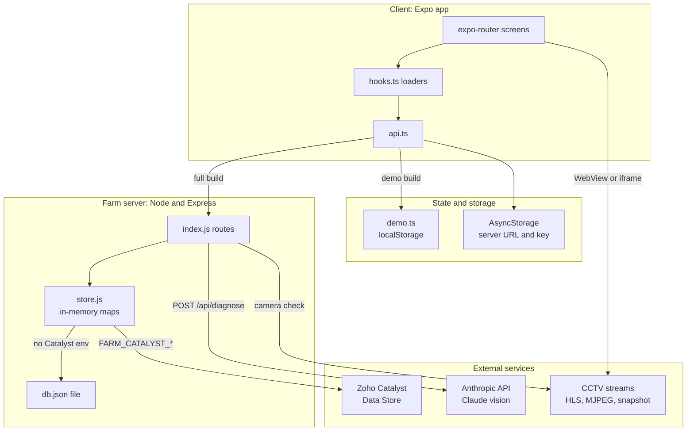
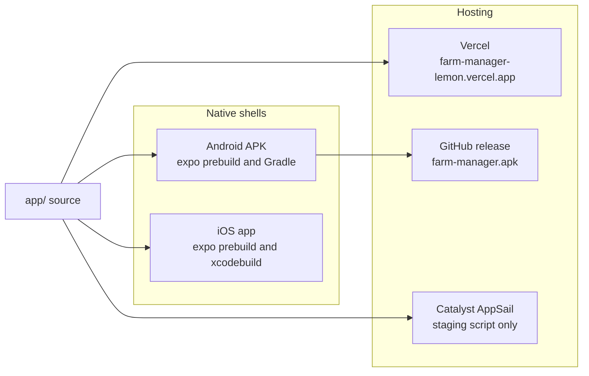
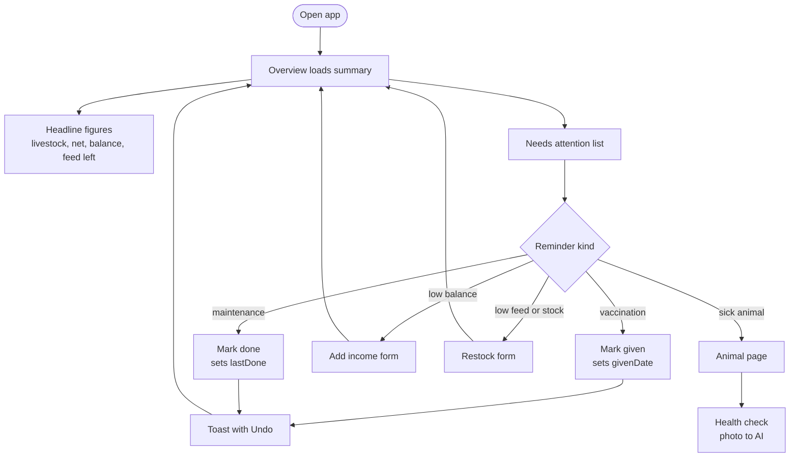
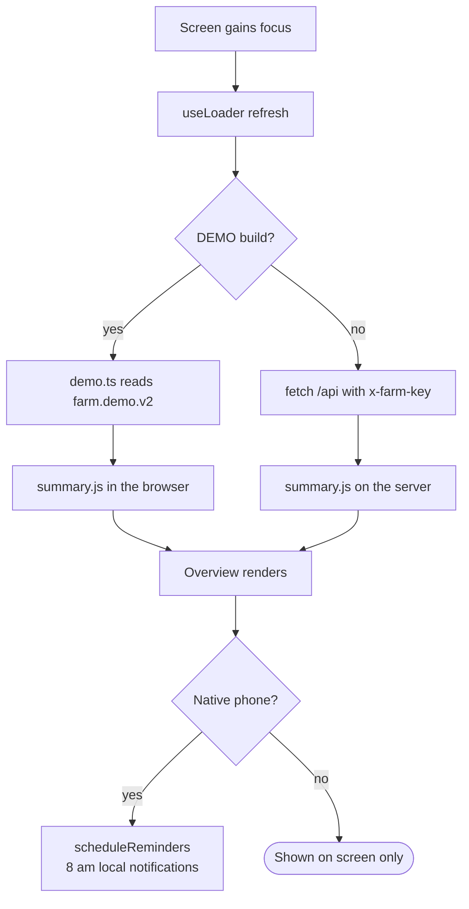
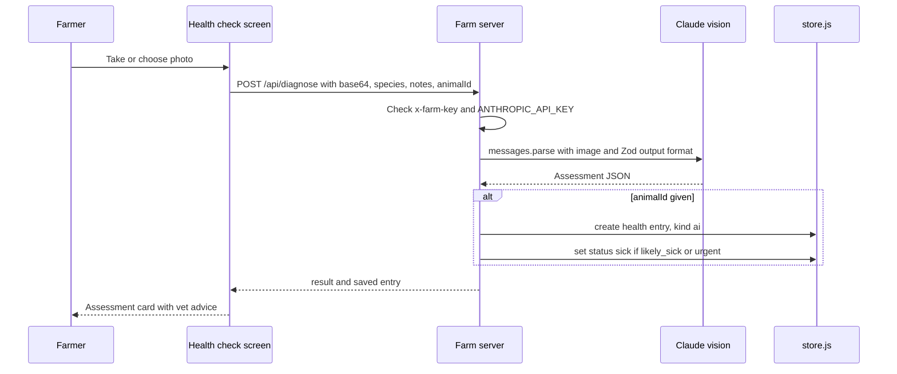
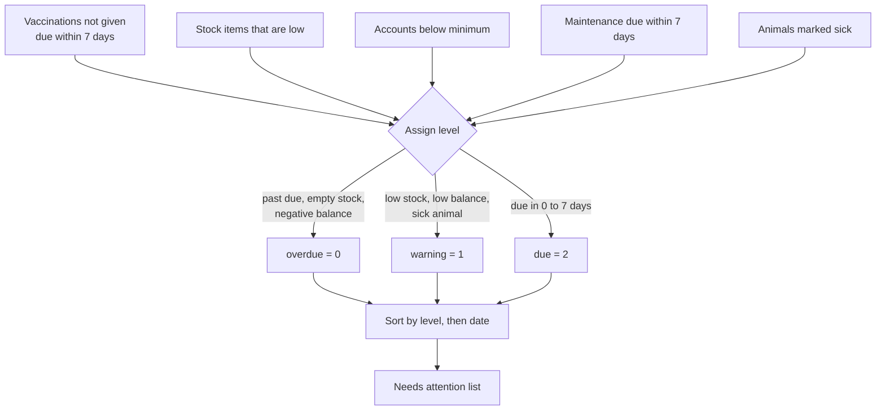
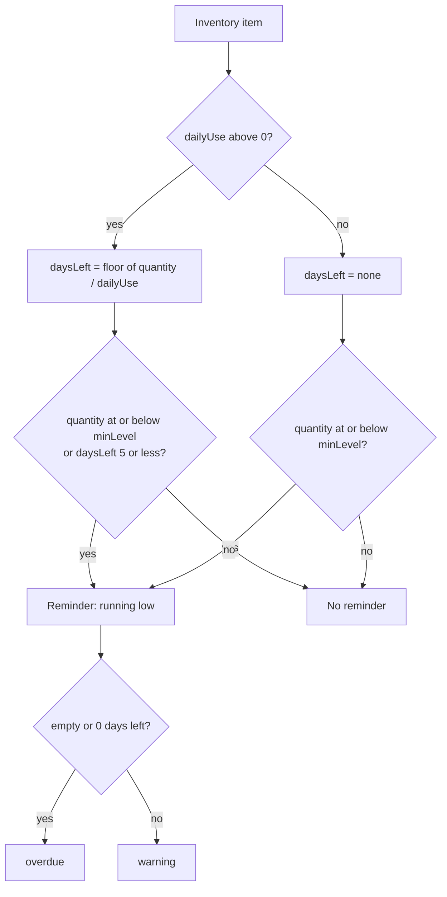
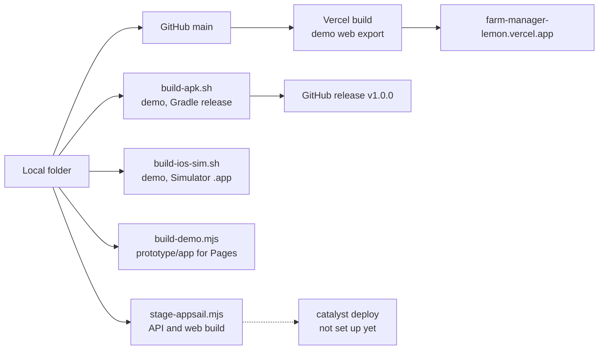

# Farm Manager

Farm Manager is one app for running a small goat, cow and chicken farm: animals and flocks, money and bank balances, feed and medicine stock, upkeep tasks, CCTV, and a photo-based AI health check. It is a single Expo (React Native) codebase that runs on iPhone, Android and the web. The main idea is that one set of pure rules (`summary.js`) works out the dashboard numbers and the "Needs attention" list, and the same file runs on the server, in the browser demo and on the phone, so the dashboard, the reminders and the notifications always agree.

| | |
|---|---|
| **Platforms** | Web, Android (APK), iOS (Simulator build). One Expo codebase. |
| **Stack** | Expo SDK 58, React Native 0.88, expo-router, TypeScript. Node and Express API. |
| **Data** | Server: Zoho Catalyst Data Store or a JSON file. Demo: localStorage. |
| **Hosting** | Vercel (web demo). Catalyst AppSail staging script for the full app. |

## System architecture

The app has two modes, picked at build time by `EXPO_PUBLIC_DEMO`. In the **full mode**, every screen talks to a small Node/Express API over `/api`. The server keeps the whole farm in memory and writes each change through to Zoho Catalyst Data Store (one table, `farm_records`) or, without Catalyst settings, to `server/data/db.json`. The server also calls Anthropic's Claude vision model for the AI health check.

In the **demo mode**, which is what the live site, the APK and the iOS Simulator build use today, the API module is swapped for `lib/demo.ts`. It seeds a sample farm, keeps it in the browser's localStorage, and runs the very same `summary.js` to build the dashboard. The AI check is switched off there because it needs the server's API key; the app says so instead of faking a result.

_Where each piece runs. The demo build never reaches the server; the full build never touches localStorage._

_Native shells and hosting. Android and iOS are real React Native builds, not web wrappers._

## Main user flow

The core job is the morning check: open the app, see what needs doing, and settle it without leaving the Overview. Each reminder row carries the one action that clears it, and every change shows a toast with Undo.

## Data flow and state

Every screen loads through `useLoader` in `hooks.ts`, which refetches whenever the screen comes into focus, so an edit on one screen shows up on the next. There is no client-side cache or sync queue: in full mode the server is the single source of truth, and in demo mode localStorage is. Records are plain JSON documents in eight collections: animals, health, vaccinations, transactions, accounts, inventory, maintenance and cameras.

| State | Where it lives |
|---|---|
| Farm records (full) | Server memory, written through to Catalyst `farm_records` (collection, rec_id, data) or `server/data/db.json` |
| Farm records (demo) | localStorage key `farm.demo.v2` in the browser. On phones there is no localStorage, so it is kept in memory until the app closes |
| Server address, access key | AsyncStorage keys `farm.serverUrl`, `farm.accessKey` |
| Reminders on the phone | Local notifications from expo-notifications, rebuilt on every dashboard load |
| Dashboard numbers | Not stored. Worked out on each request by `summary.js` |

_The same summary.js runs in both places. A server test fails if the two copies ever differ._

### The AI health check request

The photo is picked with expo-image-picker at half quality and sent as base64. The server asks Claude for a structured answer that must match a Zod schema (status, confidence, visible signs, possible conditions, advice, call the vet). If an animal was chosen, the result is saved to its health log, and a "likely sick" or "urgent" result marks the animal as sick, which then appears in Needs attention.

_The CCTV variant, POST /api/cameras/:id/check, has the server fetch a JPEG snapshot from the camera first, then runs the same check without saving it._

### How "Needs attention" is ranked

`reminders()` in `summary.js` builds one list from five sources, gives each item a level, then sorts by level (overdue first, then warning, then due this week) and, within a level, by date. Vaccinations and maintenance only appear inside a 7-day window.

### Feed stock and days left

Each inventory item can carry a quantity, a daily use and a minimum level. Days left is `floor(quantity / dailyUse)`; an item with no daily use has no days-left figure. The item counts as low when it is at or under its minimum, or when 5 days or fewer are left. The Overview's "Feed left" figure shows the feed that runs out first, and its meters fill against a 21-day scale.

_Feed items become "feed" reminders; medicine, equipment and produce become "stock" reminders._

## Key modules

| File / module | Responsibility |
|---|---|
| `app/src/app/` | expo-router screens: five tabs (Overview, Animals, Money, Stock, Cameras), animal and camera pages, one shared edit form, health check, vaccinations, settings |
| `lib/api.ts` | Server address and access key, the `request` wrapper, and the switch between the live API and the demo store |
| `lib/demo.ts` | Sample farm dated relative to today, localStorage persistence, reset |
| `lib/summary.js` | Dashboard figures, account balances, stock levels, maintenance due dates, ranked reminders. Identical to the server copy |
| `lib/hooks.ts` | Load on focus; the summary loader also schedules notifications |
| `lib/notify.ts` | 8 am local notifications on due dates and a next-morning digest of urgent items |
| `lib/schema.ts` | Field lists for every record type, so one form adds and edits all of them |
| `lib/theme.ts` | Slate and indigo palette, light and dark, the `M3` and `HIG` flags and their colour roles, Inter or San Francisco |
| `components/ui.tsx` | Shared building blocks that change shape per platform: cards, lists, buttons, chips, sheets, FAB, toast |
| `components/ios.tsx` | SF Symbols mapping, haptics, large-title navigation bar, bar buttons for the iOS look |
| `components/CameraPlayer` | Plays a camera in a WebView on phones and an iframe on the web, via a tiny HTML page |
| `server/src/index.js` | Express routes, access-key check, diagnose and camera-check routes, serves a built web app when present |
| `server/src/store.js` | In-memory collections with write-through to Catalyst or a JSON file |
| `server/src/catalyst.js` | Catalyst Data Store REST calls, OAuth refresh-token exchange, pagination |
| `server/src/diagnose.js` | Prompt, Zod schema and Claude call for the photo check |

## Platforms

All three platforms are the same React Native code. The look is chosen at run time by two flags in `app/src/lib/theme.ts`; there is no separate web wrapper or Capacitor shell for this app.

| Platform | How it is built and how it looks |
|---|---|
| Web | Expo web export (react-native-web), single-page output. Its own neutral slate look with one indigo, Inter, a sidebar from 900 px up and bottom tabs below |
| Android | `M3` flag: Material Design 3 colour roles generated by the Kolam M3 kit for the app's indigo, top app bar, navigation bar, ripples, M3 buttons, chips, fields, snackbar, sheet and FAB. Built by `scripts/build-apk.sh` |
| iOS | `HIG` flag: Apple HIG system grouped colours, San Francisco, large-title headers, floating tab bar, SF Symbols via expo-symbols, inset grouped lists, capsule buttons, sheets, haptics. Built for the Simulator by `scripts/build-ios-sim.sh` |

On the web, `?app=android` and `?app=ios` preview the two native looks, and iOS wins if both are given. The M3 and HIG looks are implemented in React Native styles here; they do not use the Kolam CSS kits that the HTML apps use, only the colour roles from the Kolam M3 generator and the Kolam iOS kit's accessible grey for secondary text.

## Data sources and APIs

| Source | Used for | Licence / key |
|---|---|---|
| Anthropic Messages API | Photo health check, structured output; model from `FARM_AI_MODEL`, default `claude-opus-5` | `ANTHROPIC_API_KEY` or `ANTHROPIC_AUTH_TOKEN`, server only |
| Zoho Catalyst Data Store | Durable storage for the hosted server | `FARM_CATALYST_PROJECT_ID`, `_CLIENT_ID`, `_CLIENT_SECRET`, `_REFRESH_TOKEN`, `_ENV`, `_TABLE`, plus `ZOHO_DC` |
| Farm CCTV | Live view (HLS, MJPEG, JPEG snapshot) and snapshot checks | The farmer's own camera URLs |
| hls.js (jsDelivr CDN) | HLS playback in browsers without native HLS | Apache 2.0, no key |
| Mux test stream | The demo farm's sample camera | Public test stream |
| Inter (Google Fonts package) | Text on web and Android | OFL |

Server access is guarded by an optional shared passphrase, `FARM_ACCESS_KEY`, which the app sends in the `x-farm-key` header. There are no user accounts; a Google sign-in was tried and removed on 13 November 2026.

## Offline, performance, privacy and accessibility

**Offline.** The demo build works fully offline after the first load because everything is in the browser. The full build has no offline queue: if the server cannot be reached, screens show an error with a Retry button. There is no service worker in the source.

**Performance.** The farm is small by design (thousands of rows), so the server keeps it all in memory and the summary is recomputed on each request. File writes are debounced by 50 ms. Photos are sent at half quality, and the API accepts bodies up to 15 MB.

**Privacy.** Demo data never leaves the device. In the full build, farm data stays on the farmer's server, and photos go only to Anthropic for the check. The API key is read on the server and never shipped to the app. `stage-appsail.mjs` copies only an allow-list of env var names into the git-ignored AppSail config.

**Accessibility.** Colour is kept for status only (amber, red, green), and every status also has a text badge. Buttons and rows carry accessibility roles and labels, iOS secondary text is darkened to pass WCAG AA, tap targets on iOS are 44 pt, and light and dark themes follow the system setting. The AI result always says it is a screening aid, not a diagnosis.

## Build and deploy

Vercel builds the web demo straight from GitHub `main` using `app/vercel.json`: `EXPO_PUBLIC_DEMO=1 npx expo export --platform web`, with every path rewritten to `index.html`. Both portfolio frames (web and mobile) load that live site, so "one sample farm, saved in your browser" is literally the demo store in `lib/demo.ts`. The local `vercel-web/` folder is an older pre-built export from 30 October with its own Vercel link; it is git-ignored, and the live site's bundle no longer matches it.

_Native builds run in a temporary copy of app/, so the repo never holds generated android/ or ios/ folders._

Tests: `cd server && npm test` covers livestock counts, monthly totals, balances, every reminder type, the stock and maintenance helpers, and checks that the app's copy of `summary.js` matches the server's. `npx tsc --noEmit` type-checks the app.

## Known limits and next steps

- The full server mode is not hosted anywhere yet. The Catalyst project and AppSail deploy, and an Anthropic key on a server, are still to do, so the public app is the demo only and the AI check is off in it.
- The APK and iOS build are demo builds too. On phones the demo farm lives in memory, so changes are lost when the app closes.
- No offline queue or conflict handling in full mode. Two phones writing the same record at once: the last write wins.
- Access is one shared passphrase, not per-person accounts.
- The low-stock thresholds differ a little by screen: reminders use 5 days, the Overview feed meter turns red at 3 and amber at 7, and the Stock tab turns red at 2. Worth unifying.
- Browsers and WebViews cannot play RTSP; such cameras need a gateway like go2rtc or MediaMTX. Camera AI checks only work when the server can reach the camera.
- The iOS build targets the Simulator only; a device build needs an Apple developer account (EAS is documented in the README).

---

Written from the source code on 17 November 2026. Source: github.com/tgopinath/farm-manager
